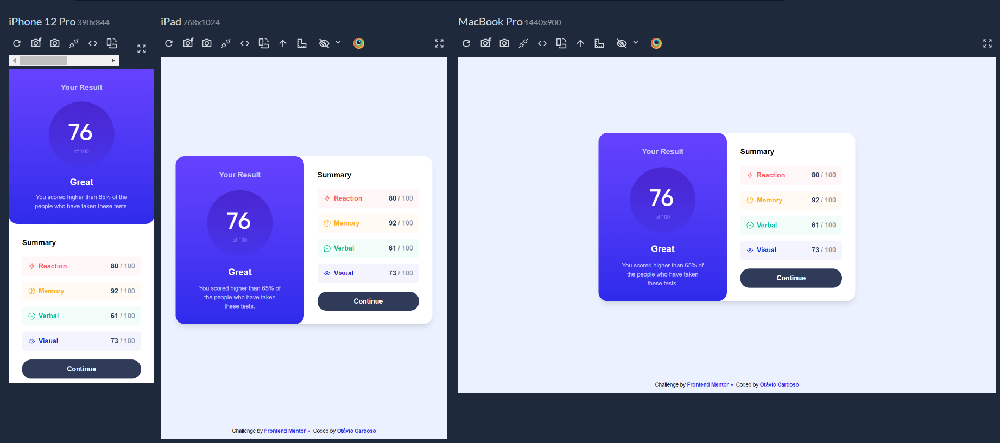

# Frontend Mentor - Results summary component solution

This is a solution to the [Results summary component challenge on Frontend Mentor](https://www.frontendmentor.io/challenges/results-summary-component-CE_K6s0maV). Frontend Mentor challenges help you improve your coding skills by building realistic projects. 

## Table of contents

- [Overview](#overview)
  - [The challenge](#the-challenge)
  - [Screenshot](#screenshot)
  - [Links](#links)
- [My process](#my-process)
  - [Built with](#built-with)
  - [What I learned](#what-i-learned)
  - [Continued development](#continued-development)
  - [AI Collaboration](#ai-collaboration)
- [Author](#author)

## Overview

### The challenge

Users should be able to:

- View the optimal layout for the interface depending on their device's screen size
- See hover and focus states for all interactive elements on the page
- **Bonus**: Use the local JSON data to dynamically populate the content

### Screenshot



### Links

- Solution URL: [Repo](https://github.com/otaviozerotwo/Results-summary-component-solution)
- Live Site URL: [Deploy](https://results-summary-component-solution-six.vercel.app/)

## My process

### Built with

- Semantic HTML5 markup
- Flexbox
- Mobile-first workflow
- [React](https://reactjs.org/) - JS library
- [Tailwind CSS](https://tailwindcss.com/) - For styles

### What I learned

During this project, I learned how to structure a React application more professionally by separating concerns into UI components, custom hooks, and a simulated API service layer. This clean architecture makes the project much easier to scale and maintain.

I also learned how to safely handle dynamic classes in Tailwind CSS. Instead of concatenating strings, I mapped the colors from the JSON data to full Tailwind classes using a dictionary object.

Here is the color mapping technique I used:

```js
const bgColorMapping = {
  red: 'bg-light-red/5 text-light-red',
  yellow: 'bg-orangey-yellow/5 text-orangey-yellow',
  green: 'bg-green-teal/5 text-green-teal',
  blue: 'bg-cobalt-blue/5 text-cobalt-blue'
}

const textColorMapping = {
  red: 'text-light-red',
  yellow: 'text-orangey-yellow',
  green: 'text-green-teal',
  blue: 'text-cobalt-blue'
}
```
Additionally, I learned how to calculate derived state efficiently using useMemo to get the average score dynamically, ensuring the UI always reflects the fetched data instead of relying on hardcoded values:

```js
const finalScore = useMemo(() => {
  if (!data || data.length === 0) {
    return 0;
  }

  const total = data.reduce((acc, item) => acc + item.score, 0);

  return Math.floor(total / data.length);
}, [data]);
```

### Continued development

In future projects, I want to replace the simulated API layer with real data fetching using libraries like React Query (TanStack Query) or SWR. This will help me handle caching, background updates, and complex loading states more efficiently. I also plan to continue deepening my knowledge of TypeScript to ensure safer, more predictable codebases with strict type definitions.

### AI Collaboration

- Tools used: Google Gemini.

- How I used it: I used the AI as a coding partner to brainstorm the best architectural structure for a React project simulating an API. We discussed best practices for separating logic from UI, handling dynamic CSS classes with Tailwind, and calculating derived state.

- What worked well: The AI was incredibly helpful in explaining why certain approaches (like creating a dictionary mapping for Tailwind or using useMemo for the score average) are considered professional standards, providing concrete, type-safe code examples that were easy to implement.

## Author

- GitHub - [@otaviozerotwo](https://github.com/otaviozerotwo)
- Frontend Mentor - [@otaviozerotwo](https://www.frontendmentor.io/profile/otaviozerotwo)